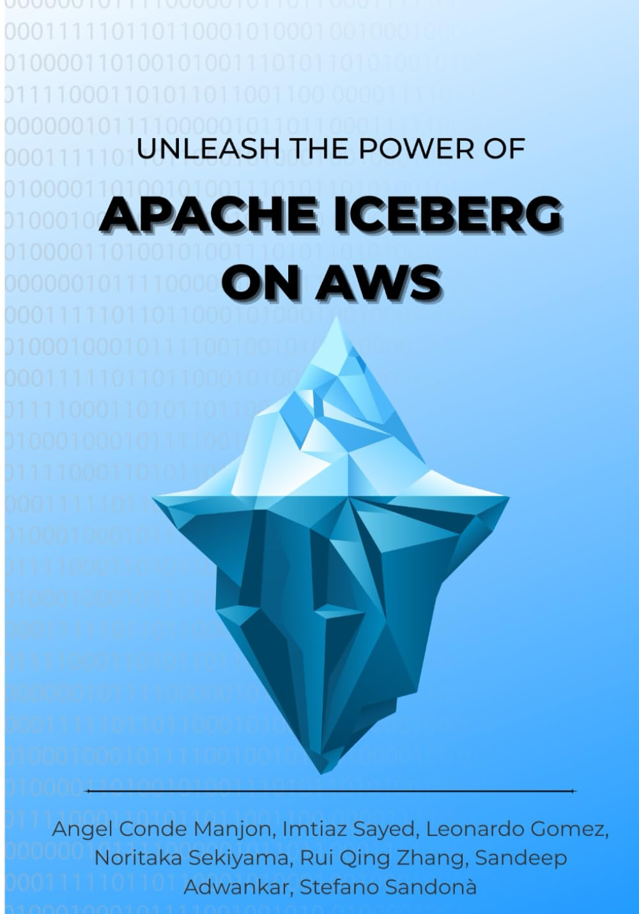

## 📘 Unleash the power of Apache Iceberg on AWS — Code Repository

This repository contains all the hands-on examples, notebooks, scripts, and reference architectures that accompany the book [Unleash the power of Apache Iceberg on AWS](https://a.co/d/gb5MNbx).

### Repository Purpose

The book is designed to be deeply practical. Every chapter comes with runnable examples so that you can:

- Learn Iceberg from fundamentals to advanced features.
- Understand AWS-native integrations (Glue Catalog, EMR, Athena, MSK, Lambda, Fargate…).
- Reproduce the same pipelines described in the book.

This repository functions as a companion lab environment to the book.

### Repository Structure

The repository mirrors the structure of the book.
Each chapter has its own directory containing the examples, scripts, configurations, or notebooks referenced in that chapter.

- [Chapter 3 - Working with Apache Iceberg Tables in AWS](chapter3_aws/)
- [Chapter 4 - Data Ingestion Patterns](chapter4_data_ingestion/)
- [Chapter 6 - Operations and Monitoring](chapter6_operations_monitoring/)
- [Chapter 8 - Apache Iceberg REST Catalog integration and Interoperability](chapter8_rest_catalog/)
- [Chapter 9 - Migrate to Apache Iceberg](chapter9_migration/)
- [Chapter 10 - Advanced Topics](chapter10_advanced/)

### Contributions

This repository is intentionally open so that practitioners can:

- Contribute additional examples
- Suggest improvements
- Add diagrams, troubleshooting notes, or performance benchmarks

PRs are welcome, especially around Iceberg engine integrations with AWS services.

### Trademark Notice

[Apache®](https://www.apache.org/), [Apache Iceberg™](https://iceberg.apache.org/), and all related marks and logos are trademarks of the Apache Software Foundation (ASF).
This repository reflects the author’s personal views and does not represent AWS or the ASF.
