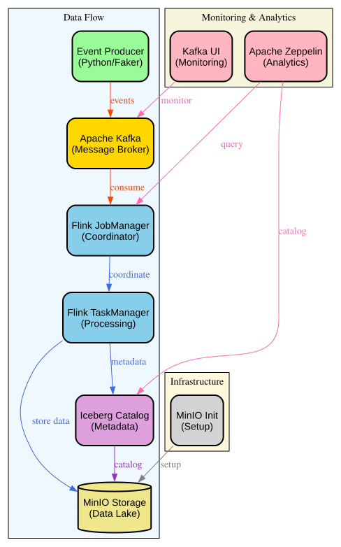

# Real-Time Event Processing Pipeline with Flink, Kafka, and Iceberg playground

Scalable data pipeline playground that demonstrates modern stream processing architecture. This project ingests real-time events through Apache Kafka, processes them with Apache Flink, and stores them in Apache Iceberg format on MinIO (S3-compatible storage) using an Apache Iceberg REST Catalog. 

Note that you can deploy this easily on top of AWS infrastructure using Amazon Managed Service para Apache Flink.

**We are not using official Zeppelin images as there is no ARM64 image**.

You can go through the different notebooks to see how you can run streaming ingestion using Flink and Iceberg.

## 🚀 Features

- **Real-time Stream Processing**: Apache Flink with exactly-once semantics
- **Event Generation**: Synthetic user interaction events 
- **Modern Lake House**: Apache Iceberg with schema evolution and time travel
- **Interactive Analytics**: Apache Zeppelin notebooks for data exploration
- **Monitoring**: Kafka UI and Flink Dashboard for operational visibility
- **Cloud-Native Storage**: MinIO S3-compatible object storage
- **Containerized Deployment**: Complete Docker Compose setup

## 📁 Structure

```
.
├── docker-compose.yml          # Complete infrastructure orchestration
├── docs/                       # Documentation and diagrams
│   ├── infra.dot              # Architecture diagram source
│   └── infra.svg              # Architecture diagram
├── flink/                     # Apache Flink configuration
│   └── Dockerfile            # Custom Flink image with connectors
├── producer/                  # Event generation service
│   ├── Dockerfile           # Python producer container
│   ├── producer.py         # Synthetic event generator
│   └── requirements.txt    # Python dependencies
└── zeppelin-custom/          # Interactive analytics environment
    ├── conf/               # Zeppelin configuration
    ├── notebook/          # Pre-built analysis notebooks
    ├── Dockerfile         # Custom Zeppelin image
    └── start.sh          # Container startup script
```

## 🛠️ Quick Start

### Prerequisites

- **Docker Engine**: 20.10.0 or later
- **Docker Compose**: v2.0.0 or later  
- **Memory**: At least 8GB RAM available for Docker
- **Ports**: 8080, 8081, 8083, 9000, 9001, 9092, 2181, 8181

### Installation


2. **Start all services**:
   ```bash
   docker compose up -d
   ```

3. **Verify deployment**:
   ```bash
   docker compose ps
   ```
   
   All services should show as "Up" or "healthy".

## 🌐 Service Access

Once deployed, access the following services:

| Service | URL | Credentials | Purpose |
|---------|-----|-------------|----------|
| **Zeppelin Notebooks** | http://localhost:8080 | - | Interactive data analysis |
| **Flink Dashboard** | http://localhost:8081 | - | Stream processing monitoring |
| **Kafka UI** | http://localhost:8083 | - | Kafka topic and message monitoring |
| **MinIO Console** | http://localhost:9001 | `minioadmin/minioadmin` | Object storage management |
| **MinIO API** | http://localhost:9000 | `minioadmin/minioadmin` | S3-compatible storage API |
| **Iceberg REST Catalog** | http://localhost:8181 | - | Table metadata management |

## 📊 Running the Pipeline

### Step 1: Start Data Processing

1. Open **Zeppelin** at http://localhost:8080

### Event Producer Settings

Modify producer behavior via environment variables in `docker-compose.yml`:

```yaml
kafka-producer:
  environment:
    MESSAGES_PER_SECOND: 0.5    # Event generation rate
    KAFKA_TOPIC: events         # Target Kafka topic
    KAFKA_RETRY_ATTEMPTS: 5     # Connection retry attempts
```

### Generated Event Schema

```json
{
  "id": "uuid4-string",
  "user_id": 1-1000,
  "event_type": "click|view|purchase|signup",
  "product_id": 1-100,
  "timestamp": "2024-01-01T12:00:00.000Z",
  "amount": 10.0-500.0,
  "country": "ISO-country-code",
  "device": "mobile|desktop|tablet"
}
```

## 🏗️ Architecture



### Data Flow

### Component Interactions

1. **Event Generation**: Python producer generates synthetic events using Faker
2. **Message Streaming**: Events published to Kafka topic with JSON serialization
3. **Stream Processing**: Flink consumes events with exactly-once semantics
4. **Data Transformation**: Events enriched with processing timestamps
5. **Data Storage**: Processed events written to Iceberg tables on MinIO
6. **Interactive Analysis**: Zeppelin provides SQL interface for data exploration
7. **Monitoring**: Dedicated UIs for each component provide operational visibility